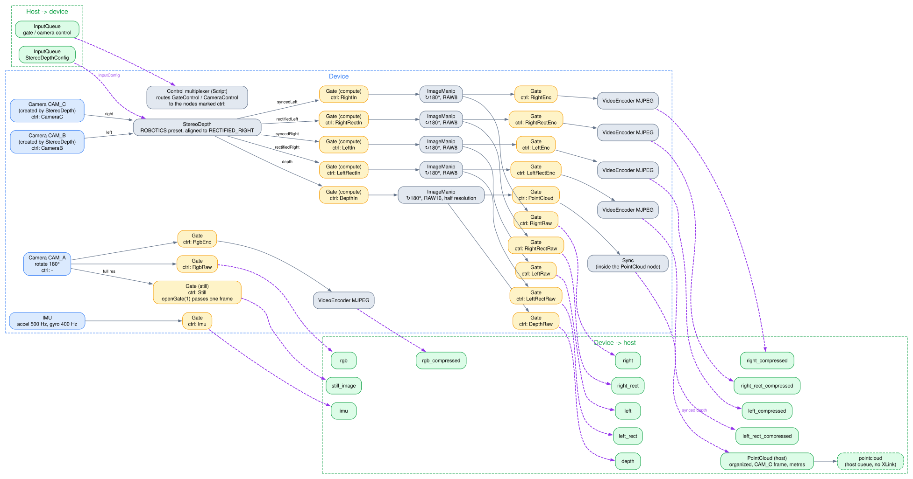

# raph_oak <!-- omit in toc -->

ROS 2 driver for the OAK-D Pro W (RVC2) camera on the Raph Rover. It is a composable node,
`raph_oak::OakWrapper`, built on DepthAI v3 and the `depthai_bridge_v3` converters.

The node builds a fixed DepthAI pipeline on the camera and publishes only what somebody
subscribes to: unused streams are neither computed on the camera nor sent over USB.

- [Topics](#topics)
- [Services](#services)
- [Parameters](#parameters)
- [The pipeline](#the-pipeline)
- [Lazy activation](#lazy-activation)
  - [Measured effect](#measured-effect)
- [Why not depthai\_ros\_driver](#why-not-depthai_ros_driver)
- [Code structure](#code-structure)
- [Editing the pipeline graph](#editing-the-pipeline-graph)

## Topics

Names are relative to the node (`~/`).

| Topic | Type | Notes |
|---|---|---|
| `rgb/image_raw`, `rgb/image_raw/compressed`, `rgb/camera_info` | Image, CompressedImage, CameraInfo | 1344×1008, 15 fps by default (bgr8) |
| `rgb_rect/image_rect`, `rgb_rect/image_rect/compressed`, `rgb_rect/camera_info` | | undistorted on the camera, same size and rate as `rgb` |
| `left/image_raw`, `left/image_raw/compressed`, `left/camera_info` | | mono8, 1280×800, 10 fps |
| `left_rect/image_rect`, `left_rect/image_rect/compressed`, `left_rect/camera_info` | | rectified |
| `right/…`, `right_rect/…` | | same as left |
| `stereo/image_raw`, `stereo/camera_info` | Image (16UC1), CameraInfo | depth, half the mono resolution |
| `points` | PointCloud2 | organized, built by DepthAI's `PointCloud` node |
| `imu/data_raw` | Imu | accelerometer 500 Hz, gyroscope 400 Hz |
| `rgb_still/image_still`, `rgb_still/camera_info` | Image, CameraInfo | full resolution (4000×3000), transient local |

## Services

| Service | Type | Notes |
|---|---|---|
| `capture_still` | std_srvs/Trigger | captures one full resolution frame and publishes it on `rgb_still/*` |

## Parameters

The parameters are generated with `generate_parameter_library` from
[`src/oak_wrapper_parameters.yaml`](src/oak_wrapper_parameters.yaml), which also holds the
descriptions, bounds and defaults. Parameters marked `read_only` there change the pipeline itself
and need a restart.

| Group | Parameters |
|---|---|
| `device` | `id`, `usb_port_id` (read only), `ir_laser_dot_projector_intensity`, `ir_laser_dot_projector_lazy`, `ir_flood_light_intensity` |
| `depth` | `confidence_threshold`, `lr_check_*`, `subpixel_*`, `extended_disparity_enabled`, `min_distance`, `max_distance` (not read only, changeable at runtime) |
| `pointcloud` | `fps` (default 5, changeable at runtime): rate limit of the depth frames fed to the point cloud node, set through the `fps` field of its gate |
| `mono`, `mono_compressed` | resolution, fps, JPEG quality (read only) |
| `rgb`, `rgb_compressed` | resolution, fps, JPEG quality, `rect_alpha_scaling` of the undistorted image (read only) |

The robot configuration is in `raph_bringup/config/oak.yaml`, the node is started by
`raph_bringup/launch/oak.launch.xml`.

## The pipeline



Solid edges stay on the camera. Purple dashed edges are XLink streams over USB. The `ctrl:` label
on a node is the `Control` enum value used to open or close it (`include/raph_oak/pipeline.hpp`).
The source of the picture is [`doc/pipeline.dot`](doc/pipeline.dot).

**Sources.** CAM_A is the RGB camera. CAM_B and CAM_C are created by the `StereoDepth` node
(ROBOTICS preset, depth aligned to the rectified right sensor, which is the `left` image after
the rotation).

**Rotation.** `ImageManip` nodes rotate the mono images and the depth by 180° on the camera.
The RGB camera is rotated at the sensor.

**Rectified RGB.** `rgb_rect` is a second output of CAM_A requested with
`enableUndistortion=true`, so the camera undistorts the image with its calibration, and it has its
own raw and encoder gates. `rgb_rect/camera_info` is built from the intrinsic matrix DepthAI
attaches to each frame (`ImgFrame::getTransformation()`), because it depends on the alpha scaling
(`rgb.rect_alpha_scaling`); the distortion coefficients are zero and the projection matrix is the
intrinsic matrix. If a frame carries no valid transformation, the rotated `rgb/camera_info` is used
with its distortion removed. Do not run `image_proc::RectifyNode` on `rgb/image_raw` next to it,
both would publish `rgb_rect/image_rect`.

**Camera info of rectified images.** The intrinsics of a rectified or undistorted image are only
known to DepthAI, not to the factory calibration, so `K` and `P` of `rgb_rect`, `left_rect`,
`right_rect` and `stereo` (depth) are taken from every frame
(`getTransformation().getIntrinsicMatrix()`) and the distortion is zero. DepthAI describes the
180° rotation done by an `ImageManip` with negated focal lengths and a principal point flipped as
`w - cx`; both are converted to the convention of the other camera infos (positive focal
lengths, `w - 1 - cx`). The rotation done by the CAM_A sensor is not part of the transformation,
so the principal point of `rgb_rect` is flipped here. The rectification rotation `R` and the
baseline come from the calibration. `R` is conjugated with the 180° rotation (the terms coupling x
or y with z change sign), and the baseline is kept in metres, so `P[3]` of `right_rect` is
`-fx * baseline` with the `fx` of that frame and `P[3]` of `left_rect` is zero. `left_rect` and
`right_rect` share `K`: DepthAI rectifies both onto the intrinsics of the sensor behind `left`. For
depth, which is aligned to that sensor at half the mono resolution, `R` is the identity and `P[3]`
is zero. If a frame carries no valid transformation, the calibration based camera info is used
instead (for depth: the `left_rect` one scaled to the depth resolution).

**Three kinds of gates.** Every Gate starts closed and is opened by the host only while someone
needs the data behind it:

| Gate | Sits in front of | Purpose |
|---|---|---|
| compute (`*In`) | the `ImageManip` | a closed gate keeps the rotation, the encoder and everything behind it idle |
| raw (`*Raw`) | the raw XLink output | raw and compressed images can be requested independently |
| encoder (`*Enc`) | the MJPEG encoder | nothing is encoded or sent while nobody listens |

**Control multiplexer.** All gates and the two stereo sensors are controlled through a single
XLink input stream. The host sends a one byte target id followed by the control message
(`GateControl` or `CameraControl`) and a `Script` node routes it to the target. The control queue
is blocking: a dropped message would misalign the header/message pairs. This keeps the
pipeline at **18 XLink streams** (16 device→host, 2 host→device: control and `StereoDepthConfig`),
well below the XLink limit of 32 streams. Two things do not work on RVC2 and are
the reason for the separate header message: the sequence number of a message is not preserved on
its way to the script, and building a `GateControl` inside the script crashes the device.

**Point cloud.** On RVC2 the DepthAI `PointCloud` node runs on the host. Only the (gated) depth
crosses USB, as a synced message, and the cloud is computed on the host.

**Still image.** The full resolution output of CAM_A feeds a Gate that is told to pass exactly
one frame (`GateControl::openGate(1)`), which is what `capture_still` does. The full resolution
stream itself keeps running on the camera while the node runs (about 130 MB of device memory and a
few percent of CPU, independent of the requested fps).

**Stereo sensors.** CAM_B and CAM_C are stopped with `CameraControl::setStopStreaming()` while no
stereo-derived topic (depth, point cloud, left, right and their rectified versions) is
subscribed, and restarted in roughly 120 ms when one is.

## Lazy activation

The node checks the subscriber counts every 100 ms.

| Subscribed to | Opened on the camera |
|---|---|
| `*/image_raw`, `*/image_rect`, `rgb/image_raw`, `rgb_rect/image_rect` | the raw gate (and the compute gate for stereo images) |
| `*/image_raw/compressed`, `*/image_rect/compressed` | the encoder gate (and the compute gate) |
| only `rgb`, `rgb_rect`, `left`, `right`, `left_rect` or `right_rect` `*/camera_info` | the encoder gate: camera info is published from the compressed stream, which is cheaper to transfer than the raw image |
| `stereo/camera_info` | the depth gates, like `stereo/image_raw` |
| `stereo/image_raw` or `points` | depth compute gate; the depth raw gate and/or the point cloud gate; the IR laser dot projector (if `ir_laser_dot_projector_lazy`) |
| `imu/data_raw` | the IMU gate |
| anything stereo derived | the stereo sensors are started, otherwise stopped |

### Measured effect

Measured on one OAK-D Pro W with the default parameters. "Payload" is what the host receives per
second through the XLink queues (wire level USB traffic was not measured); the load is the camera's
own LEON CSS / MSS usage from the `SystemLogger` node. The reference for "no lazy activation" is
every gate open, which is what a driver without on-camera activation does all the time. All
numbers below were measured before the `rgb_rect` streams existed, so the reference covers 13
streams. The two `rgb_rect` streams have the same size as `rgb` and `rgb_compressed` and would add
about 33 MB/s to it (not measured).

Payload of a single stream:

| Stream | Payload (MB/s) |
|---|---|
| `rgb/image_raw` (1344×1008 NV12, 15 fps) | 30.5 |
| `rgb/image_raw/compressed` | 2.3–2.7 |
| each of `left`, `left_rect`, `right`, `right_rect` raw (1280×800, 10 fps) | 10.2 |
| each of the four compressed mono streams | 0.8–0.95 |
| `stereo/image_raw` (depth) | 5.1 |
| `points` | a second copy of the depth, about 5.1 (not counted below) |
| `imu/data_raw` | 0.02 |

Scenarios:

| Subscribed | Payload (MB/s) | vs. everything on | LEON CSS / MSS |
|---|---|---|---|
| nothing | 0 | −100% | 14% / 2.5% |
| `rgb/image_raw/compressed` only | ≈ 2.5 (estimate from the table above) | ≈ −97% | not measured |
| `rgb/image_raw` | 30.5 | −63% | 17% / 2.5% |
| `left_rect/image_rect/compressed` only | 0.77 | −99% | 27% / 17% |
| `left_rect/image_rect` | 10.2 | −88% | 27% / 17% |
| depth + point cloud | 5.1 (+ ≈ 5.1 for the point cloud's copy, estimate) | ≈ −88% | 33% / 17% |
| **everything** (all 13 streams) | **82.8** (+ ≈ 5.1 point cloud copy) | reference | **55% / 30%** |

Without lazy activation the camera therefore moves about 83–88 MB/s of payload and sits at roughly
55% / 30% load even if nothing is subscribed, which is more than USB 2.0 can carry (about
40 MB/s in practice). With it, the cost follows the subscribers: an idle camera moves nothing and
stays near 14% / 2.5%. Most of the remaining idle load is CAM_A with its full resolution output
(see the pipeline section).

## Why not depthai_ros_driver

`depthai_ros_driver` (the `depthai-ros` package) is a general purpose driver: a plugin based
framework that can assemble many pipeline types, sensors and neural network nodes from `i_*`
parameters. `raph_oak` is deliberately the opposite, one fixed pipeline for one camera on one
robot. The reasons visible in the history of this package (`feat: Add custom OAK wrapper (#8)`
and the commits after it) and in the source of the upstream driver:

- **Lazy publishing is host side only.** The upstream driver's lazy publisher
  (`i_enable_lazy_publisher`) only skips the ROS publish when nobody subscribes: the frame has
  already been computed on the camera and sent over USB. `raph_oak` stops the work on the camera
  itself, which is where the CPU and the USB bandwidth are spent (see [Measured effect](#measured-effect)).
- **Rotation and camera info.** The camera is mounted upside down. The wrapper rotates every
  stream on the camera and swaps left and right (including their camera infos), and the history
  shows work specifically on getting the depth rotation and the camera info right.
- **A fixed, small interface.** The commit that introduced the wrapper replaced the driver setup
  in `raph_bringup` with one composable node, one parameter file (`config/oak.yaml`) and the
  parameters the robot needs ("update the launch file to use the custom wrapper and remove
  redundant nodes").
- **Robot specific features.** Reconnect when the camera disappears, the IR projector
  parameters and lazy laser control, runtime depth configuration through ROS parameters, native
  point cloud publishing in the camera's CAM_C frame and the `capture_still` service.

If one of these stops being true, for example upstream gaining on-camera lazy activation, this
decision should be revisited. The motives above are reconstructed from the history and the
source, so correct them if the actual reasons differ.

## Code structure

| File | Role |
|---|---|
| `streams.hpp` | Table of the image streams (`ImageStreams`): topics, frame ids, gates and how the camera info is made. The publishers, the queue callbacks and the subscriber based activation are all loops over it |
| `control.hpp` | `Control`, a target of the control channel, with its log name and properties |
| `demand.hpp/.cpp` | `Demand`: subscriber counts → what each stream needs → gate states; plus the stereo sensor start/stop (with the restart delay), laser intensity and point cloud rate. No DepthAI, no ROS |
| `pipeline.hpp/.cpp` | Builds the DepthAI pipeline and defines the control channel |
| `camera_info.hpp/.cpp` | Camera info conversions |
| `oak_wrapper.hpp/.cpp` | The node: connects to the camera, counts subscribers, applies the decisions of `demand` and publishes |
| `test/test_demand.cpp` | Unit tests of the table and of `demand` (run with `colcon test --packages-select raph_oak`) |

To add an image stream, add an entry to `ImageStreamId` and `ImageStreams`, the gates it uses to
`Control::Value` (and `Control::name()`), and build its nodes with `make_image_queues` in `pipeline.cpp`.
Nothing else in the node changes: the topics, the publishers, the callbacks and the activation
follow from the table. Add the stream to `doc/pipeline.dot` as well.

## Editing the pipeline graph

`doc/pipeline.dot` is written and maintained by hand. Adding an output to `pipeline.cpp` means one
node plus one internal edge plus one XLink edge in the file. To regenerate the picture:

```sh
dot -Tsvg doc/pipeline.dot -o doc/pipeline.svg
```

`xdot doc/pipeline.dot` gives an interactive view. A dump of the real pipeline can be used to
check the graph: `dai::Pipeline::serializeToJson()` after `start()` lists the nodes, and the
number of `XLinkIn` plus `XLinkOut` nodes must match the stream count above.
